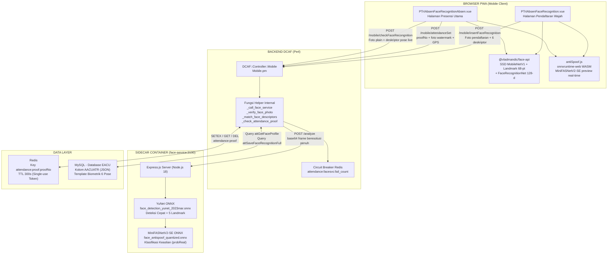
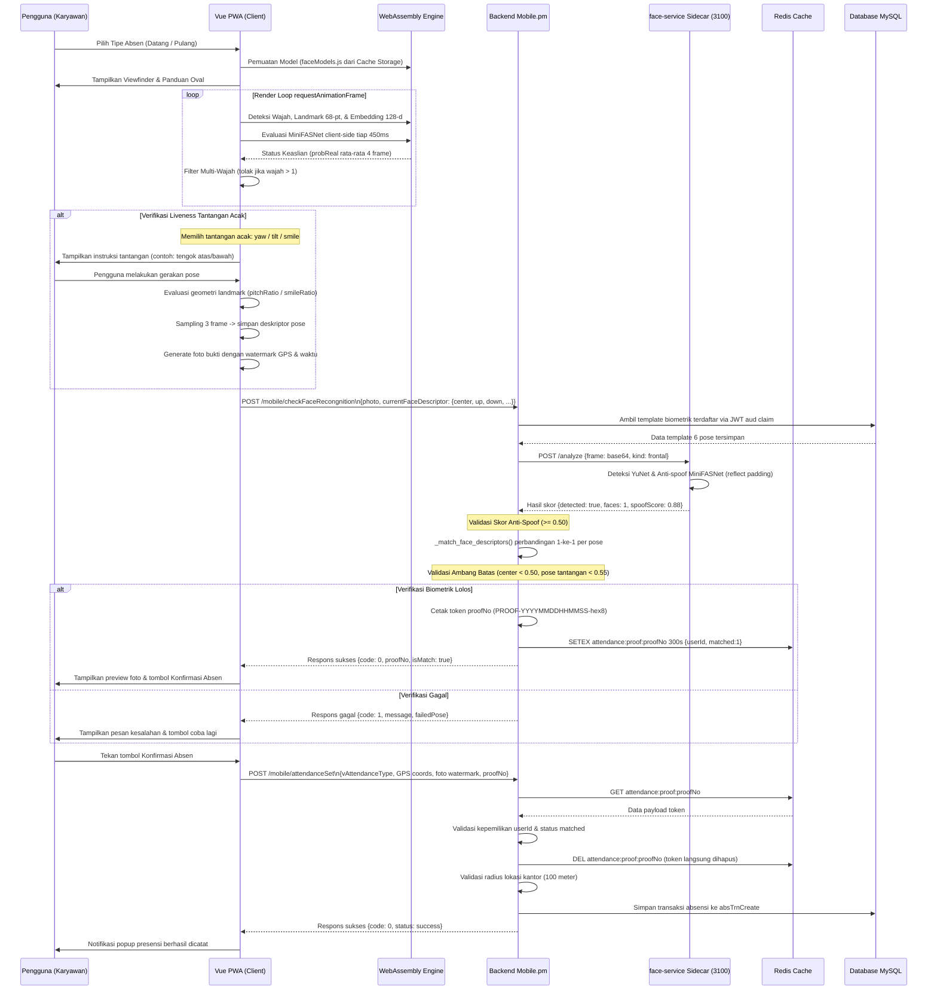

# 02. Desain Arsitektur Sistem

## 2.1 Arsitektur Tiga Lapisan (Three-Tier Topology)

Sistem mengadopsi arsitektur terpisah antara Client Edge PWA, Backend Controller Perl (DCAF Framework), dan Microservice AI Sidecar Container.

---

## 2.2 Sequence Diagram Alur Presensi Kehadiran

Diagram berikut mengilustrasikan interaksi seluruh komponen dari inisiasi kamera hingga pencatatan transaksi kehadiran:

---

## 2.3 Peran Setiap Lapisan

### 1. Sisi Klien (PWA di Browser Ponsel)
- Mengakses kamera perangkat melalui `navigator.mediaDevices.getUserMedia()`.
- Menjalankan inferensi ringan secara lokal: deteksi landmark 68-titik, ekstraksi embedding, dan evaluasi anti-spoofing awal via WebAssembly.
- Mengelola antarmuka pengguna: instruksi tantangan acak, visual guide ring (merah/hijau), penghitung waktu mundur sesi (45 detik), dan pembentukan watermark koordinat serta waktu pada foto.

### 2. Sisi Sidecar AI (`face-service:3100`)
- Microservice mandiri berbasis Node.js 18 yang dikemas dalam Docker container terisolasi.
- Menjalankan model **YuNet** untuk deteksi bounding box berkecepatan tinggi (~230 KB) dan **MiniFASNetV2-SE** untuk klasifikasi citra asli vs spoof.
- Melakukan normalisasi citra masukan dengan konteks 1.5x *reflect padding* dan *downscale* INTER_AREA agar identik dengan distribusi data saat model dilatih.
- Mengembalikan keputusan authoritative `spoofScore` dan penolakan multi-wajah.

### 3. Sisi Backend Controller (`Mobile.pm` DCAF Perl)
- Menjadi gerbang otentikasi utama dan penegak kebijakan keamanan (*security enforcer*).
- Menghubungkan komunikasi antar-layanan menggunakan *circuit breaker* berbasis Redis.
- Menjalankan algoritma pencocokan biometrik pose-ke-pose (*same-pose matching*) dengan prinsip *zero-leak biometrics*.
- Menerbitkan dan mengonsumsi token sekali pakai `proofNo` berumur 300 detik.
