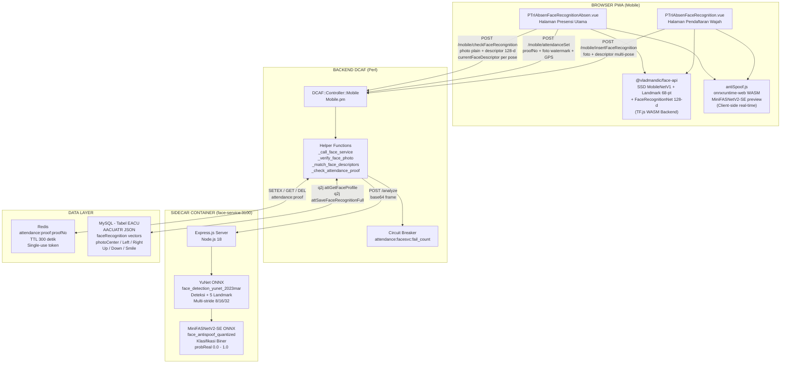
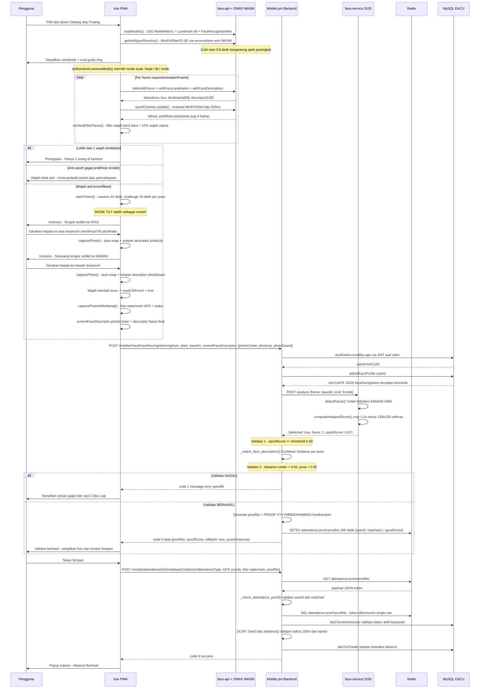

# Laporan Penambahan & Refaktorisasi Fitur Face Recognition Absensi
## Branch: `face-attendance-human` | Aplikasi SWB (Wahana SWB App)

**Versi Dokumen:** 1.1  
**Tanggal:** 13 Oktober 2026  
**Penulis:**  
**Periode Kontribusi:** 30 September 2026 - 13 Oktober 2026  
**Total Commit:** 18 commit | 31 file changed | +9.973 insertions | -718 deletions

---

## Daftar Isi

1. [Executive Summary](#1-executive-summary)
2. [Log Kontribusi & Evolusi Teknis (18 Commits Journey)](#2-log-kontribusi--evolusi-teknis-18-commits-journey)
3. [Arsitektur Sistem Terbaru](#3-arsitektur-sistem-terbaru-current-state-architecture)
4. [Penambahan Teknis Mendalam](#4-penambahan-teknis-mendalam-deep-dive-features-added)
5. [Project Structure: Pemetaan Berkas](#5-project-structure-pemetaan-berkas-yang-ditambahkan--dimodifikasi)
6. [Batasan Sistem & Rencana Selanjutnya](#6-batasan-sistem--rencana-selanjutnya)
7. [Referensi Teknis](#7-referensi-teknis)

---

## 1. Executive Summary

### 1.1 Konteks dan Tujuan

Branch `face-attendance-human` diinisiasi untuk membangun sistem presensi kehadiran nirsentuh berbasis pengenalan wajah (face recognition) pada aplikasi mobile PWA SWB. Sistem ini dirancang untuk menggantikan mekanisme presensi QR Code yang rentan terhadap praktik <mark style="background-color: #bae6fd;">titip absen (buddy punching)</mark>, sekaligus memvalidasi lokasi GPS karyawan secara <mark style="background-color: #bae6fd;">server-side</mark>.

Nama branch menggunakan sufiks `-human` karena eksplorasi teknis awal dimulai menggunakan library `@vladmandic/human` sebagai kandidat utama engine AI di sisi client.

### 1.2 Masalah yang Diselesaikan

**Masalah Performa dan Bundle Size:**

Selama fase eksplorasi, ditemukan bahwa library `@vladmandic/human` membawa seluruh pipeline ML-nya (BlazeFace, FaceMesh, FaceEmbedding, Iris, Liveness) dalam satu paket. Bundle JavaScript-nya berukuran sangat besar (puluhan ribu baris, beberapa MB) yang menyebabkan cold start lambat di browser mobile. Bersamaan dengan itu, model Human berjalan di atas TensorFlow.js yang pada perangkat Android entry-level menghasilkan inferensi per frame yang terlalu lambat untuk pengalaman pengguna yang responsif.

Keputusan pivot dibuat pada commit ke-7 (`928d5cfb`) untuk <mark style="background-color: #fef08a;">menanggalkan @vladmandic/human</mark> sepenuhnya dan mengganti strategi menjadi arsitektur split yang jauh lebih efisien menggunakan <mark style="background-color: #fef08a;">@vladmandic/face-api</mark> di client dan <mark style="background-color: #bae6fd;">YuNet</mark> di microservice sidecar.

**Kapabilitas Baru yang Dihadirkan:**

1. **Deteksi anti-spoofing ganda (<mark style="background-color: #fef08a;">Dual Anti-Spoofing Pipeline</mark>):** <mark style="background-color: #bae6fd;">MiniFASNetV2-SE</mark> berjalan di browser (via <mark style="background-color: #bae6fd;">onnxruntime-web WASM</mark>) sebagai preview real-time, dan diverifikasi ulang di sidecar container saat foto dikirim ke server.
2. <mark style="background-color: #fef08a;">**Tantangan pose yang diperluas:**</mark> Sistem liveness kini mendukung tiga mode tantangan - toleh kiri/kanan (head yaw), <mark style="background-color: #bae6fd;">tengok atas/bawah (head tilt/pitch)</mark>, dan <mark style="background-color: #bae6fd;">senyum (smile)</mark> - yang dipilih secara acak setiap sesi.
3. <mark style="background-color: #fef08a;">**Server-Side Same-Pose Matching & Zero-Leak Biometrics:**</mark> Migrasi verifikasi pencocokan wajah dari browser ke backend Perl (`Mobile.pm`). Setiap pose tantangan live dicocokkan spesifik dengan template pose yang sama saat pendaftaran (<mark style="background-color: #bae6fd;">same-pose comparison</mark>), dan <mark style="background-color: #fef08a;">data template biometrik tidak pernah lagi dibocorkan ke client</mark>.
4. **Pengamanan transaksi dengan token sekali pakai:** Token <mark style="background-color: #bae6fd;">proofNo</mark> berbasis Redis dengan <mark style="background-color: #fef08a;">TTL 300 detik</mark> yang di-generate setelah validasi wajah dan langsung <mark style="background-color: #bae6fd;">dikonsumsi (dihapus)</mark> saat presensi dicatat.

---

## 2. Log Kontribusi & Evolusi Teknis (18 Commits Journey)

Delapan belas commit dalam branch ini membentuk lima fase evolusi yang jelas, dari eksplorasi awal hingga implementasi sistem yang produktif.

### Ikhtisar Timeline Commit

| No | Hash | Tanggal | Pesan Commit | Fase |
|---|---|---|---|---|
| C-01 | `982860cd` | 2026-09-30 | feat: add human liveness detection page and model integration | Fase 1 |
| C-02 | `1d1c6677` | 2026-09-30 | Add Face-Recognition Attendance System Queries and Controller | Fase 1 |
| C-03 | `5cc5c1d3` | 2026-10-01 | feat: add face enrollment page and routing | Fase 1 |
| C-04 | `7077fc60` | 2026-10-01 | fix: improve camera initialization and error handling | Fase 1 |
| C-05 | `8c8caf18` | 2026-10-02 | Enhance face detection and challenge handling | Fase 1 |
| C-06 | `928d5cfb` | 2026-10-05 | <mark style="background-color: #fef08a;">refactor(face): remove Human-based flow, use YuNet</mark> | <mark style="background-color: #bae6fd;">Fase 2 - PIVOT</mark> |
| C-07 | `30124b61` | 2026-10-05 | <mark style="background-color: #bae6fd;">refactor(face): reject multiple faces on enroll/attendance</mark> | Fase 2 |
| C-08 | `a5a2a833` | 2026-10-06 | <mark style="background-color: #fef08a;">feat: integrate anti-spoofing functionality</mark> | Fase 3 |
| C-09 | `27881b6d` | 2026-10-08 | feat: add Dockerfile and docker-compose for face service | Fase 3 |
| C-10 | `aa51a845` | 2026-10-08 | Enhance anti-spoofing functionality and UI feedback | Fase 3 |
| C-11 | `66fd49df` | 2026-10-08 | <mark style="background-color: #fef08a;">feat: enhance liveness checks with tilt and smile detection</mark> | <mark style="background-color: #bae6fd;">Fase 4</mark> |
| C-12 | `b6048de4` | 2026-10-09 | feat: refactor user profile resolution logic | Fase 4 |
| C-13 | `3c5b89f9` | 2026-10-12 | <mark style="background-color: #fef08a;">fix: load face models once, in parallel, with warm-up</mark> | <mark style="background-color: #bae6fd;">Fase 5</mark> |
| C-14 | `ac588bd8` | 2026-10-12 | fix: prevent camera from running after component unmounts | Fase 5 |
| C-15 | `4962d6cb` | 2026-10-12 | feat: enhance anti-spoofing preprocessing and adjust threshold | Fase 5 |
| C-16 | `4fcf749b` | 2026-10-12 | feat: prevent multiple simultaneous detections (isStarting flag) | Fase 5 |
| C-17 | `1d407b2e` | 2026-10-12 | <mark style="background-color: #fef08a;">feat: pose sampling and persistent model file caching</mark> | Fase 5 |
| C-18 | `0b8b1ab0` | 2026-10-13 | <mark style="background-color: #bae6fd;">feat: retry logic for face enrollment on network issues</mark> | Fase 5 |

---

### Fase 1: Fondasi Awal & Eksplorasi Spike (30 Sep - 02 Okt 2026)

**Commit C-01 — `982860cd` — 30 Sep 2026**

```
feat: add human liveness detection page and model integration
```

Titik awal seluruh pengembangan. Dilakukan instalasi dependency `@vladmandic/human` dan pengujian library tersebut melalui halaman spike `PSpikeHuman.vue`. Pada commit ini, model-model milik Human (blazeface, facemesh, faceres, iris, liveness, antispoof) ditambahkan ke direktori `public/models/human/` sebagai bundel lokal.    

File yang ditambahkan:
- `web/dev/dcaf/src/pages/PSpikeHuman.vue` (halaman pengujian spike)
- `web/dev/dcaf/public/models/human/*.bin` dan `*.json` (8 model file)
- Modifikasi `quasar.conf.js` untuk transpile `@vladmandic/human`
- Modifikasi `router/routes.js` untuk mendaftarkan rute spike

**Commit C-02 — `1d1c6677` — 30 Sep 2026**

```
Add Face-Recognition Attendance System Queries and Controller
```

Pembangunan fondasi backend secara bersamaan. Commit ini menginisiasi tiga komponen penting sekaligus:

- `lib/db/git/attendance_queries.sql` — Skrip query DDL/DML untuk manajemen profil biometrik (attGetFaceProfile, attSaveFaceRecognitionFull, log bukti percobaan, dll.)
- `lib/perl/DCAF/Controller/Attendance.pm` — Controller dedicated untuk alur challenge berbasis sesi multi-langkah
- `etc/api/attendance.yaml` — Dokumentasi OpenAPI endpoint attendance challenge
- Modifikasi `Mobile.pm` untuk menambahkan enforcing `proofNo` pada operasi `attendanceSet`
- Inisiasi `containers/dev/face-service/server.js` dengan versi awal (masih menggunakan `@vladmandic/human` di sisi sidecar)

**Commit C-03 — `5cc5c1d3` — 01 Okt 2026**

```
feat: add face enrollment page and routing
```

Implementasi UI pendaftaran wajah. `PTrIAbsenFaceEnroll.vue` dibuat dengan integrasi kamera dan instruksi langkah demi langkah untuk pengguna melakukan pendaftaran multi-pose. Routing untuk alur enrollment dan attendance ditambahkan ke `routes.js`.

**Commit C-04 — `7077fc60` — 01 Okt 2026**

```
fix: improve camera initialization and error handling
```

Perbaikan bug: inisialisasi kamera yang gagal pada beberapa perangkat Android akibat race condition antara `getUserMedia()` dan pemuatan model AI. Penambahan penanganan error eksplisit untuk kondisi kamera tidak tersedia atau akses ditolak.

**Commit C-05 — `8c8caf18` — 02 Okt 2026**

```
Enhance face detection and challenge handling in attendance and enrollment pages
```

Penyempurnaan alur deteksi dan challenge pada kedua halaman (enrollment dan attendance). Peningkatan logika state machine untuk transisi antar pose tantangan.

---

### Fase 2: Pivot Arsitektur & Optimasi Bundle (05 Okt 2026)

Fase ini adalah titik paling kritis dalam perjalanan 18 commit: keputusan untuk membuang seluruh fondasi yang dibangun pada Fase 1 di sisi engine AI, dan menggantinya dengan arsitektur yang lebih ringan dan modular.

**Commit C-06 — `928d5cfb` — 05 Okt 2026 [PIVOT UTAMA]**

```
refactor(face): remove Human-based enroll/attendance flow, use YuNet in face-service
```

Ini adalah commit dengan dampak terbesar. Keputusan arsitektur (ADR) yang dibuat:

**Alasan Pivot:**
- <mark style="background-color: #fef08a;">`@vladmandic/human` memiliki bundle yang terlalu besar</mark> untuk dijalankan efisien di browser mobile
- API Human (FaceMesh, BlazeFace, dll.) sulit diintegrasikan dengan pipeline anti-spoof kustom yang diinginkan
- Model Human di sidecar container menghasilkan kompleksitas dependency yang tidak perlu
- <mark style="background-color: #bae6fd;">YuNet dari OpenCV Zoo</mark> lebih ringan (~230 KB), lebih cepat, dan merupakan standar industri yang terdokumentasi dengan baik

**Yang Dihapus (D = Deleted):**
- `PSpikeHuman.vue` — halaman spike tidak lagi diperlukan
- `PTrIAbsenFaceAttendance.vue` — digantikan oleh `PTrIAbsenFaceRecognitionAbsen.vue`
- `PTrIAbsenFaceEnroll.vue` — digantikan oleh `PTrIAbsenFaceRecognition.vue`
- `lib/perl/DCAF/Controller/Attendance.pm` — controller sesi multi-langkah dihilangkan
- `etc/api/attendance.yaml` — dokumentasi API lama dihapus
- `public/models/human/*.bin` dan `*.json` (10 file model Human)
- `public/js/human.esm.js` dan `human.js`

**Yang Ditambahkan (A = Added):**
- <mark style="background-color: #bae6fd;">`containers/dev/face-service/models/face_detection_yunet_2023mar.onnx`</mark> — model YuNet
- <mark style="background-color: #fef08a;">`web/dev/dcaf/src/assets/js/antiSpoof.js`</mark> — module wrapper ONNX Runtime Web baru
- <mark style="background-color: #bae6fd;">`web/dev/dcaf/public/js/ort.min.js`</mark> — ONNX Runtime Web runtime
- <mark style="background-color: #bae6fd;">`web/dev/dcaf/public/js/ort-wasm-simd-threaded.wasm`</mark> — WASM binary untuk ONNX

**Yang Dipindahkan (R = Renamed/Moved):**
- `public/models/human/face_antispoof_quantized.onnx` -> `public/models/face_antispoof_quantized.onnx` (dipertahankan, hanya dipindahkan path-nya)

**Commit C-07 — `30124b61` — 05 Okt 2026**

```
refactor(face): reject multiple faces on enroll/attendance
```

Penguatan keamanan langsung setelah pivot. Logika penolakan frame ditambahkan di dua lapisan (<mark style="background-color: #fef08a;">Multi-Face Rejection</mark>):

1. **Client-side:** Jika <mark style="background-color: #bae6fd;">`detectedCount > 1`</mark>, sistem menolak melanjutkan proses liveness dan menampilkan peringatan kepada pengguna.
2. **Server-side (face-service):** `faceCount > 1` dari sidecar mengembalikan error <mark style="background-color: #bae6fd;">`MULTIPLE_FACES`</mark> yang diterima dan ditolak oleh `Mobile.pm`.

---

### Fase 3: Anti-Spoofing Ganda & Visual Feedback (06 - 08 Okt 2026)

**Commit C-08 — `a5a2a833` — 06 Okt 2026**

```
feat: integrate anti-spoofing functionality and enhance face recognition flow
```

Integrasi penuh `antiSpoof.js` ke dalam kedua halaman Vue. Perubahan utama:

- Penambahan dependency <mark style="background-color: #fef08a;">`@vladmandic/face-api`</mark> ke `package.json` (sebagai pengganti Human untuk deteksi + landmark + embedding di client)
- <mark style="background-color: #bae6fd;">`createLiveSpoofChecker()`</mark> di-instantiasi di `created()` hook dan dijalankan per frame di `detectLoop()`
- <mark style="background-color: #bae6fd;">Timer sesi (45 detik)</mark> dan <mark style="background-color: #bae6fd;">timer tantangan (10 detik per fase)</mark> diperkenalkan
- Logika cooldown 30 detik setelah 3 kali timeout sesi diimplementasikan

**Commit C-09 — `27881b6d` — 08 Okt 2026**

```
feat: add Dockerfile and docker-compose configuration for face service
```

Formalisasi deployment sidecar AI. `Dockerfile` menggunakan base image `node:18-bullseye-slim`, mengekspos <mark style="background-color: #bae6fd;">port 3100</mark>, dan mendefinisikan startup command `node server.js`. Container terisolasi sepenuhnya dari backend Perl.

**Commit C-10 — `aa51a845` — 08 Okt 2026**

```
Enhance anti-spoofing functionality and UI feedback
```

Penyempurnaan UX dan tuning anti-spoof:

- Dynamic path retrieval untuk WASM script `ort.min.js` menggunakan `document.querySelector('script[src*="ort.min.js"]')` agar bekerja di berbagai environment (dev vs production)
- Threshold anti-spoof default disesuaikan dan slider tuning ditambahkan di panel pengaturan
- Visual feedback disempurnakan: ring oval berwarna <mark style="background-color: #bae6fd;">merah (fake/checking)</mark> atau <mark style="background-color: #bae6fd;">hijau (real)</mark>, badge status di atas kotak wajah
- Skor probabilitas real (`spoofChecker.scoreText()`) ditampilkan di label untuk membantu tuning threshold di lapangan

---

### Fase 4: Liveness Enhancement & Backend Hardening (08 - 09 Okt 2026)

**Commit C-11 — `66fd49df` — 08 Okt 2026**

```
feat: enhance face recognition liveness checks with tilt and smile detection
```

Commit ini membawa dua lapis perubahan fundamental (salah satunya merupakan perubahan arsitektur besar di backend yang **tidak tercatat lengkap pada pesan commit git**):

1. **Pembaruan Liveness di Frontend (Tercatat di Git Commit):**
   - Penggantian pose `mulut terbuka` (mouth open) dengan dua pose baru yang lebih andal:
     - <mark style="background-color: #fef08a;">**Head Tilt (Pitch):**</mark> Deteksi gerakan kepala atas/bawah berbasis rasio vertikal landmark hidung terhadap garis mata-dagu. Pose lama (mouth open) dihapus total.
     - <mark style="background-color: #fef08a;">**Smile Detection:**</mark> Deteksi senyum berbasis rasio lebar sudut mulut terhadap jarak antar mata.
   - Pengambilan foto per pose yang berhasil kini menyimpan vektor deskriptor baru: `photoUp`, `photoDown`, `photoSmile`.
   - Setting sensitivitas tilt (`tiltDelta`) ditambahkan ke panel pengaturan untuk kalibrasi lapangan.

2. **Perombakan Arsitektur Biometrik di Backend (Hidden Enhancement / Omission in Commit Message):**
   Meskipun pesan git hanya berfokus pada UI tilt & smile, diff pada `Mobile.pm` (+157 baris) dan `PTrIAbsenFaceRecognitionAbsen.vue` (-233 baris) melakukan refaktorisasi arsitektur biometrik paling signifikan di proyek ini:
   - <mark style="background-color: #fef08a;">**Migrasi dari Client-Side Matching ke Server-Side Matching:**</mark> Sebelumnya, server mengirimkan seluruh template biometrik pengguna (`storedDescriptors`) ke browser, lalu browser menghitung Euclidean distance di client. Di commit ini, seluruh kalkulasi dipindahkan ke server demi keamanan (<mark style="background-color: #fef08a;">Zero-Leak Biometrics</mark>). Template biometrik tersimpan tidak pernah lagi meninggalkan server.
   - <mark style="background-color: #fef08a;">**Same-Pose Verification (`_match_face_descriptors`):**</mark> Ditambahkan algoritma perbandingan pose-to-pose di backend. Live pose saat absensi <mark style="background-color: #bae6fd;">HANYA</mark> dibandingkan dengan enrolled pose yang sama (`photoCenter` vs `photoCenter`, `photoLeft` vs `photoLeft`, `photoRight` vs `photoRight`, `photoUp` vs `photoUp`, `photoDown` vs `photoDown`, `photoSmile` vs `photoSmile`).
   - <mark style="background-color: #bae6fd;">**Multi-Threshold Matching:**</mark> Menerapkan threshold ketat untuk pose netral/lurus (`0.50`) dan threshold fleksibel untuk pose tantangan (`0.55`).
   - <mark style="background-color: #bae6fd;">**Pengenalan `_check_attendance_proof()`:**</mark> Logika validasi single-use token di Redis diperketat dengan 4 kode verifikasi dan konsumsi token secara langsung (`DEL`).

File yang dimodifikasi: `PTrIAbsenFaceRecognition.vue`, `PTrIAbsenFaceRecognitionAbsen.vue`, `lib/perl/DCAF/Controller/Mobile.pm`, `etc/dcaf.yaml`

**Commit C-12 — `b6048de4` — 09 Okt 2026**

```
feat: refactor user profile resolution logic and enhance attendance state handling
```

Refaktorisasi logika resolusi identitas pengguna di `Mobile.pm` untuk operasi `insertFaceRecognition` dan `checkFaceRecongnition`. Perubahan urutan prioritas identifikasi:

**Sebelum (logika lama):**
```
1. idUser (dari request body) -> langsung dijadikan userId
2. jika gagal: code (employee code)
3. jika gagal: JWT aud claim
```

**Sesudah (logika baru - lebih aman):**
```
1. JWT aud claim -> TERLEBIH DAHULU (identitas terverifikasi kriptografis)
2. jika gagal: code (employee code)
3. jika gagal: idUser dari body (sebagai fallback terakhir)
```

Alasan refaktor: Memastikan bahwa untuk pengguna yang sedang login, identitas selalu diambil dari JWT token yang telah diverifikasi oleh middleware auth, bukan dari parameter body yang dapat dimanipulasi. Parameter `idUser` di body kini hanya berfungsi sebagai fallback terakhir untuk kasus penggunaan non-authenticated (misalnya admin mendaftarkan wajah karyawan lain).

---

### Fase 5: Performa, Stabilitas & Ketahanan Jaringan (12 - 13 Okt 2026)

Fase ini berfokus pada pengalaman pengguna di perangkat nyata: waktu tunggu loading model, stabilitas pencocokan wajah, dan ketahanan terhadap sinyal lemah.

**Commit C-13 — `3c5b89f9` — 12 Okt 2026**

```
fix: every check-in reloaded about 13 MB of face models from scratch
```

Sebelumnya setiap kali presensi, ~13 MB model dimuat ulang dari awal, satu per satu, dan kamera baru menyala setelah semua model selesai. Perubahan:

- <mark style="background-color: #fef08a;">**Load sekali, pakai ulang:**</mark> File baru `faceModels.js` menyimpan model yang sudah dimuat selama sesi aplikasi. Presensi kedua dan seterusnya tidak mengunduh atau membangun ulang model.
- **Load paralel:** SSD MobileNet, Face Landmark, Face Recognition, dan Anti-Spoof dimuat bersamaan, bukan berurutan.
- **Warm-up:** Setiap model dijalankan sekali pada gambar kosong setelah dimuat, sehingga frame kamera pertama tidak tersendat.
- **Kamera menyala selama loading:** Di kedua halaman, kamera dibuka bersamaan dengan proses loading model.
- **Preload di halaman presensi:** Model mulai dimuat di background saat halaman dibuka, selagi pengguna memilih jenis absen.

**Commit C-14 — `ac588bd8` — 12 Okt 2026**

```
fix: prevent camera from running after component unmounts
```

Kamera dan loop deteksi kini dihentikan saat pengguna meninggalkan halaman, sehingga kamera tidak tetap menyala di background (hemat baterai dan privasi).

**Commit C-15 — `4962d6cb` — 12 Okt 2026**

```
feat: enhance anti-spoofing preprocessing and adjust threshold for improved accuracy
```

Preprocessing input MiniFASNet disamakan dengan kondisi saat training:

- **Sidecar (`server.js`):** Crop wajah 1.5x kini memakai <mark style="background-color: #bae6fd;">reflect padding</mark> jika keluar batas gambar (bukan terpotong), lalu downscale ke 128x128 dengan metode setara <mark style="background-color: #bae6fd;">INTER_AREA</mark> (resize ke kelipatan 128 lalu `avgPool`). Seluruh operasi dibungkus `tf.tidy()` agar tidak bocor memori.
- **Browser (`antiSpoof.js`):** Downscale canvas memakai `imageSmoothingQuality = 'high'` agar mendekati hasil di sidecar.
- <mark style="background-color: #fef08a;">**Threshold:**</mark> `antiSpoofThreshold` di kedua halaman dinaikkan dari `0.40` menjadi `0.50`.

**Commit C-16 — `4fcf749b` — 12 Okt 2026**

```
feat: prevent multiple simultaneous detections by introducing isStarting flag
```

Flag `isStarting` mencegah `startDetection()` berjalan dua kali bersamaan (misalnya karena tombol ditekan berulang atau restart cepat), yang sebelumnya dapat membuka dua stream kamera / dua loop deteksi.

**Commit C-17 — `1d407b2e` — 12 Okt 2026**

```
feat: implement pose sampling for improved face recognition stability and caching of model files
```

- <mark style="background-color: #fef08a;">**Pose sampling (`poseSampler.js`):**</mark> Descriptor per pose tidak lagi diambil dari satu frame, melainkan rata-rata dari <mark style="background-color: #bae6fd;">3 frame berturut-turut</mark> pada pose yang sama (jeda antar frame maks. 700 ms, jika lewat sampel diulang). Frame tunggal saat kepala masih bergerak sering blur sehingga jarak pencocokan di server tidak stabil.
- <mark style="background-color: #fef08a;">**Cache file model persisten (`modelCache.js`):**</mark> File model (face-api, ONNX, WASM) disimpan di <mark style="background-color: #bae6fd;">Cache Storage</mark> browser (`face-models-v1`), sehingga tetap tersimpan walau aplikasi ditutup. Jika cache tidak tersedia, otomatis fallback ke fetch biasa. Versi cache dinaikkan jika file model diganti.
- **Preload global:** `PlainLayout.vue` mulai memuat model di background 3 detik setelah aplikasi tampil.
- **Log jarak per pose:** `checkFaceRecognition` di `Mobile.pm` mencatat hasil match, pose gagal, skor spoof, dan jarak tiap pose untuk analisis kasus "wajah tidak cocok".
- **Dev build:** ESLint webpack plugin dinonaktifkan pada mode dev (`quasar.conf.js`) untuk mempercepat cold start; lint tetap via `npm run lint`.

**Commit C-18 — `0b8b1ab0` — 13 Okt 2026**

```
feat: implement retry logic for face recognition enrollment to handle network issues
```

Pengiriman pendaftaran wajah (`POST /mobile/insertFaceRecognition`) kini memakai helper `postEnrollWithRetry()`:

- Maksimal <mark style="background-color: #bae6fd;">3 percobaan</mark>, timeout 30 detik per percobaan, jeda 2 detik lalu 4 detik.
- <mark style="background-color: #fef08a;">Retry hanya untuk gangguan jaringan</mark> (timeout, tanpa response, HTTP 5xx). Penolakan dari server (`code !== 0`, misalnya spoof / wajah tidak terdeteksi) tidak diulang.
- Aman diulang karena server menimpa profil wajah user yang sama (tidak membuat duplikat).
- Selama retry, loading menampilkan "Koneksi lambat, mencoba ulang (2/3)...". Jika tetap gagal, foto dan descriptor tetap tersimpan sehingga pengguna cukup menekan Kirim lagi tanpa mengulang pose.

---

## 3. Arsitektur Sistem Terbaru (Current State Architecture)

### 3.1 Diagram Arsitektur Komponen



### 3.2 Diagram Sequence Alur Presensi Lengkap



---

## 4. Penambahan Teknis Mendalam (Deep-Dive Features Added)

### 4.1 <mark style="background-color: #fef08a;">Dual Anti-Spoofing Pipeline</mark>

Sistem mengimplementasikan dua lapisan anti-spoofing yang berjalan secara independen. Pendekatan ini memberikan keamanan berlapis: lapisan pertama memberikan feedback real-time kepada pengguna di browser, lapisan kedua memberikan keputusan final yang bersifat authoritative di server.

**Lapisan 1 - Client-side (<mark style="background-color: #bae6fd;">Browser WASM</mark>):**

Diimplementasikan di <mark style="background-color: #bae6fd;">`antiSpoof.js`</mark> sebagai helper module yang di-import oleh kedua halaman Vue. Eksekusi inferensi model <mark style="background-color: #fef08a;">MiniFASNetV2-SE quantized</mark> langsung di browser menggunakan <mark style="background-color: #bae6fd;">`onnxruntime-web`</mark> dengan execution provider `wasm`.

```javascript
// Proses per frame (dipanggil dari detectLoop via spoofChecker.update())
// 1. Crop wajah dengan konteks 1.5x dari bounding box face-api
const cropSize = Math.round(maxDim * 1.5)

// 2. Render crop ke canvas offscreen 128x128
offscreenCtx.drawImage(videoEl, sx, sy, sw, sh, 0, 0, 128, 128)

// 3. Konversi ke tensor NCHW Float32 [1, 3, 128, 128] range [0, 1]
const tensorData = new Float32Array(3 * 128 * 128)
// Channel R di [0..16384], G di [16384..32768], B di [32768..49152]

// 4. Inferensi ONNX dan softmax
const results = await session.run({ input: tensor })
const logits = results.output.data  // [real_logit, spoof_logit]
const probReal = Math.exp(logits[0]) / (Math.exp(logits[0]) + Math.exp(logits[1]))
```

Implementasi <mark style="background-color: #bae6fd;">`createLiveSpoofChecker()`</mark> menggunakan windowed average dari 4 skor terakhir untuk menstabilkan output dan mencegah label anti-spoof berkedip-kedip (flicker) di UI:

```javascript
this.history.push(res.probReal)
if (this.history.length > 4) this.history.shift()
this.score = this.history.reduce((a, b) => a + b, 0) / this.history.length
```

Sejak C-15, threshold client-side disamakan dengan server (0.50). Skor client hanya dipakai untuk feedback real-time di layar; keputusan final tetap di server.

**Lapisan 2 - Server-side (<mark style="background-color: #bae6fd;">face-service Sidecar</mark>):**

Foto final dikirim ke sidecar via `_call_face_service()` di `Mobile.pm`. Sidecar menjalankan pipeline yang sama namun dengan foto beresolusi penuh (bukan stream video), memberikan hasil yang lebih akurat:

```javascript
// server.js - computeAntispoofScore()
// YuNet mendeteksi wajah dan memberikan bounding box
const faces = await detectFaces(tensor)
const face = faces.reduce((a, b) => (b.w * b.h > a.w * a.h ? b : a)) // wajah terbesar

// Crop 1.5x identik dengan client untuk konsistensi skor (C-15)
const cropSize = Math.floor(maxDim * 1.5)
let crop = imgTensor.toFloat().slice([y1, x1, 0], [y2 - y1, x2 - x1, 3])
// Jika crop keluar batas gambar: reflect padding (bukan terpotong)
crop = tf.mirrorPad(crop, [padY, padX, [0, 0]], 'reflect')
// Downscale setara INTER_AREA: resize ke kelipatan 128 lalu rata-rata blok k x k
const k = Math.ceil(Math.max(crop.shape[0], crop.shape[1]) / 128)
resized = tf.avgPool(tf.image.resizeBilinear(crop, [128 * k, 128 * k]).expandDims(0), k, k, 'valid')
const probReal = expR / (expR + expS)        // softmax dari logit ONNX
```

Skor dari sidecar bersifat **final dan mengikat**: jika <mark style="background-color: #fef08a;">`spoofScore < 0.50`</mark>, backend menolak request tanpa memandang hasil client-side.

Backend juga mengimplementasikan <mark style="background-color: #fef08a;">**circuit breaker**</mark> untuk ketahanan sistem:

```perl
# Mobile.pm - _call_face_service()
my $isDown = eval { $redis->get('attendance:facesvc:down') };
return { ok => 0, circuit_open => 1 } if $isDown;

# Jika sidecar gagal 3x dalam 60 detik, circuit breaker terbuka
if ($fails >= $threshold) {
    eval { $redis->setex('attendance:facesvc:down', 60, 1) };
}
```

### 4.2 <mark style="background-color: #fef08a;">Multi-Face Rejection</mark>

Penolakan multi-wajah diimplementasikan di tiga titik berbeda secara berlapis:

**Titik 1 - Client render loop (`detectLoop`):**

```javascript
// sortAndFilterFaces() - filter wajah kecil (poster, background)
const minArea = area(sorted[0]) * 0.10  // 10% dari wajah terbesar
return sorted.filter(d => area(d) >= minArea)

// Jika lebih dari 1 wajah setelah filter:
if (isMultiFace) {
    statusLabel = `LEBIH DARI 1 WAJAH (${resized.length})`
    if (this.sessionDeadline) this.stopTimers()  // timer dihentikan
}
```

Efek: proses liveness tidak dapat dilanjutkan selama ada lebih dari satu wajah di frame (<mark style="background-color: #bae6fd;">`detectedCount > 1`</mark>).

**Titik 2 - Sidecar face-service:**

```javascript
// server.js - setelah NMS
const faceCount = faces.filter(f => f.w * f.h >= face.w * face.h * 0.1).length
if (faceCount > 1) {
    return res.json({ detected: true, faces: faceCount, error: 'MULTIPLE_FACES' })
}
```

**Titik 3 - Backend Mobile.pm:**

```perl
# _verify_face_photo()
if ($d->{error} && $d->{error} eq 'MULTIPLE_FACES') {
    return { ok => 0, message => 'Lebih dari satu wajah terdeteksi.', data => {...} };
}
```

### 4.3 Algoritma Liveness Pose Baru (Landmark 68-titik)

**<mark style="background-color: #fef08a;">Head Tilt Detection (Pitch)</mark> - `checkFaceTilt()`:**

Berbeda dengan pendekatan sederhana sebelumnya (mouth open menggunakan dua titik), deteksi tilt menggunakan rasio geometri vertikal yang dinormalisasi terhadap proporsi wajah setiap individu:

```javascript
// Titik landmark yang digunakan:
// pts[36], pts[39], pts[42], pts[45] = sudut-sudut mata (untuk garis mata)
// pts[30] = ujung hidung (nose tip)
// pts[8]  = dagu (chin)

const eyeY = (pts[36].y + pts[39].y + pts[42].y + pts[45].y) / 4
const noseY = pts[30].y
const chinY = pts[8].y
const faceHeight = chinY - eyeY

// Rasio: posisi hidung di antara mata dan dagu
this.pitchRatio = faceHeight > 0 ? (noseY - eyeY) / faceHeight : 0
```

Kalibrasi personal dilakukan dengan mengambil rata-rata 10 frame pertama sebagai baseline netral (`pitchBaseline`). Deteksi atas/bawah berdasarkan deviasi dari baseline sebesar <mark style="background-color: #bae6fd;">`tiltDelta` (default 0.08)</mark>, dapat dikonfigurasi via slider:

```javascript
if (pitchRatio < pitchBaseline - tiltDelta) currentRawTilt = 'up'
else if (pitchRatio > pitchBaseline + tiltDelta) currentRawTilt = 'down'
```

Pendekatan kalibrasi personal ini lebih andal dibanding threshold absolut karena setiap orang memiliki proporsi wajah yang berbeda.

**<mark style="background-color: #fef08a;">Smile Detection</mark> - `checkSmile()`:**

```javascript
// Titik landmark yang digunakan:
// pts[48], pts[54] = sudut mulut kiri dan kanan (outer)
// pts[36], pts[45] = sudut mata kiri dan kanan terluar

const mouthWidth = Math.abs(pts[54].x - pts[48].x)
const eyeDistance = Math.abs(pts[45].x - pts[36].x)

// Normalisasi terhadap jarak antar mata untuk invariansi skala
this.smileRatio = eyeDistance > 0 ? mouthWidth / eyeDistance : 0

// Hysteresis untuk mencegah flicker
const isSmiling = smileRatio > smileThreshold      // threshold buka: 0.60
const notSmiling = smileRatio < smileThreshold * 0.95  // threshold tutup: 0.57
```

**Alasan Penggantian Mouth Open dengan Tilt + Smile:**

Pose mulut terbuka (`checkMouthOpen()`) dihapus karena dua kelemahan fundamental:
1. Deteksi terlalu sensitif terhadap variasi resolusi kamera dan kondisi pencahayaan — batas bibir atas-bawah sulit terdeteksi akurat pada kamera depan beresolusi rendah.
2. Pengguna merasa tidak nyaman dan tindakan membuka mulut lebar di depan kamera terasa invasif untuk konteks aplikasi kerja.

Tilt dan smile memberikan gerakan yang lebih alami, mudah dipahami, dan lebih andal secara geometri.

### 4.4 <mark style="background-color: #fef08a;">Server-Side Same-Pose Face Matching</mark> (Comparison Enroll vs Absensi Pose)

Sebelum commit `66fd49df`, sistem menggunakan arsitektur lama: endpoint `checkFaceRecongnition` mengembalikan template biometrik pengguna (`faceRec` tersimpan) ke browser, lalu browser menghitung jarak Euclidean di client. Ini memiliki dua kelemahan fatal:
1. **Kebocoran Data Biometrik:** Vektor template pengguna terekspos di jaringan dan memori JavaScript browser.
2. **Matching Tidak Spesifik Pose:** Live pose dicocokkan sembarangan terhadap semua pose tersimpan untuk mencari kemiripan tertinggi, sehingga memungkinkan lolosnya pose yang salah.

Pada commit `66fd49df`, seluruh pencocokan dipindahkan ke backend (`Mobile.pm`) menggunakan helper <mark style="background-color: #bae6fd;">`_match_face_descriptors()`</mark> dengan prinsip <mark style="background-color: #fef08a;">**Same-Pose Verification**</mark>:

```perl
# lib/perl/DCAF/Controller/Mobile.pm
sub _match_face_descriptors {
    my ($ros, $live, $stored, $cfg) = @_;

    my $centerThreshold = $cfg->{matchThreshold} || 0.50;
    my $poseThreshold   = $cfg->{poseMatchThreshold} || 0.55;
    $live ||= {};

    my %poseDistances;
    my $failedPose;

    # 1. Pose Wajib: Netral / Lurus (photoCenter) dengan threshold ketat 0.50
    my $centerDist = _face_distance($live->{photoCenter}, $stored->{photoCenter});
    if (defined $centerDist) {
        $poseDistances{center} = sprintf('%.4f', $centerDist) + 0;
        $failedPose = 'center' if $centerDist >= $centerThreshold;
    } else {
        $failedPose = 'center';
    }

    # 2. Pengecekan 1-ke-1 untuk Tiap Pose Tantangan (Same-Pose Only)
    my %poseKeys = (
        left  => 'photoLeft',
        right => 'photoRight',
        up    => 'photoUp',
        down  => 'photoDown',
        smile => 'photoSmile'
    );

    for my $pose (sort keys %poseKeys) {
        my $key = $poseKeys{$pose};
        # Skip jika pose tersebut tidak dijalankan saat absen atau belum di-enroll
        next unless $live->{$key} && $stored->{$key};

        my $dist = _face_distance($live->{$key}, $stored->{$key});
        if (defined $dist) {
            $poseDistances{$pose} = sprintf('%.4f', $dist) + 0;
            # Gagal jika jarak pose melebihi threshold 0.55
            $failedPose //= $pose if $dist >= $poseThreshold;
        } else {
            $failedPose //= $pose; # descriptor rusak / panjang berbeda
        }
    }

    return {
        isMatch       => $failedPose ? 0 : 1,
        failedPose    => $failedPose,
        poseDistances => \%poseDistances,
    };
}
```

**Mekanisme Perbandingan Tiap Pose (<mark style="background-color: #bae6fd;">For-Each Pose Comparison</mark>):**
- <mark style="background-color: #bae6fd;">`photoCenter`</mark> (live saat absen) **HANYA** dibandingkan dengan <mark style="background-color: #bae6fd;">`photoCenter`</mark> (saat pendaftaran). Jarak harus <mark style="background-color: #fef08a;">$< 0.50$</mark>.
- <mark style="background-color: #bae6fd;">`photoLeft`</mark> (live toleh kiri) **HANYA** dibandingkan dengan <mark style="background-color: #bae6fd;">`photoLeft`</mark> (saat pendaftaran). Jarak harus <mark style="background-color: #fef08a;">$< 0.55$</mark>.
- <mark style="background-color: #bae6fd;">`photoRight`</mark> (live toleh kanan) **HANYA** dibandingkan dengan <mark style="background-color: #bae6fd;">`photoRight`</mark> (saat pendaftaran). Jarak harus <mark style="background-color: #fef08a;">$< 0.55$</mark>.
- <mark style="background-color: #bae6fd;">`photoUp`</mark> (live tengok atas) **HANYA** dibandingkan dengan <mark style="background-color: #bae6fd;">`photoUp`</mark> (saat pendaftaran). Jarak harus <mark style="background-color: #fef08a;">$< 0.55$</mark>.
- <mark style="background-color: #bae6fd;">`photoDown`</mark> (live tengok bawah) **HANYA** dibandingkan dengan <mark style="background-color: #bae6fd;">`photoDown`</mark> (saat pendaftaran). Jarak harus <mark style="background-color: #fef08a;">$< 0.55$</mark>.
- <mark style="background-color: #bae6fd;">`photoSmile`</mark> (live tersenyum) **HANYA** dibandingkan dengan <mark style="background-color: #bae6fd;">`photoSmile`</mark> (saat pendaftaran). Jarak harus <mark style="background-color: #fef08a;">$< 0.55$</mark>.

**Karakteristik Keamanan Tambahan:**
- <mark style="background-color: #fef08a;">**Fail-Fast (Zero-Tolerance Failure):**</mark> Jika ada *satu saja* pose tantangan yang jaraknya $\ge 0.55$, verifikasi langsung ditolak (`isMatch: 0`), dan backend mencatat pose mana yang gagal (`failedPose`).
- **Backward Compatibility:** Klausul `next unless $live->{$key} && $stored->{$key}` memastikan pengguna lama yang mendaftar sebelum ada pose tilt/smile tetap dapat absen tanpa kegagalan sistem.
- <mark style="background-color: #fef08a;">**Zero-Leak Biometric Policy:**</mark> Respons API `checkFaceRecongnition` tidak lagi berisi template biometrik, melainkan hanya mengembalikan status:
  ```json
  {
    "code": 0,
    "status": "success",
    "data": {
      "isMatch": true,
      "proofNo": "PROOF-20261009112345-3f8a1b2c",
      "poseDistances": { "center": 0.3421, "up": 0.4102, "down": 0.3891 }
    }
  }
  ```

### 4.5 <mark style="background-color: #fef08a;">Token Proofing & Session Hardening</mark>

**Penerbitan Token:**

```perl
# Mobile.pm - checkFaceRecongnition (setelah semua validasi lolos)
my $proofNo = sprintf("PROOF-%04d%02d%02d%02d%02d%02d-%08x",
    $lt[5]+1900, $lt[4]+1, $lt[3], $lt[2], $lt[1], $lt[0],
    int(rand(0xFFFFFFFF))
);

my $proofPayload = {
    proofNo    => $proofNo,
    userId     => $userId,
    spoofScore => $spoofScore,
    matched    => 1,
    timestamp  => time(),
};
$redis->setex("attendance:proof:$proofNo", 300, encode_json($proofPayload));
```

**Validasi dan Konsumsi Atomik:**

```perl
# Mobile.pm - _check_attendance_proof()
sub _check_attendance_proof {
    my ($ros, $proofNo, $userId) = @_;
    return { code => '01', msg => '...' } unless $proofNo;

    my $key = "attendance:proof:$proofNo";
    my $raw = $redis->get($key);
    return { code => '02', msg => '... expired ...' } unless $raw;

    my $proof = decode_json($raw);
    return { code => '03', msg => '... userId mismatch ...' }
        unless $proof->{userId} eq $userId;
    return { code => '04', msg => '... not matched ...' }
        unless $proof->{matched};

    # Konsumsi token - hapus dari Redis, tidak bisa dipakai lagi
    eval { $redis->del($key) };
    return undef;  # undef = sukses
}
```

Token bersifat <mark style="background-color: #fef08a;">single-use</mark> dan memiliki <mark style="background-color: #fef08a;">TTL 300 detik</mark> untuk mencegah serangan replay.

**Refaktor Resolusi Identitas (C-12):**

Urutan resolusi pengguna diubah untuk memprioritaskan identitas yang terverifikasi kriptografis (<mark style="background-color: #bae6fd;">JWT-First</mark>):

```
Urutan Baru (JWT-First):
1. JWT aud claim -> dcafGetAccountByLogin -> attGetFaceProfile
2. Fallback: employee code (vCode) -> attGetFaceProfileByIdOrCode
3. Fallback terakhir: idUser dari body -> attGetFaceProfile
```

Logika ini diterapkan identik di kedua operasi `insertFaceRecognition` dan `checkFaceRecongnition` untuk konsistensi.

---

## 5. Project Structure: Pemetaan Berkas yang Ditambahkan / Dimodifikasi

Tabel berikut merangkum semua berkas yang terdampak dalam 18 commit di branch ini.

| Berkas | Status | Fase | Peran |
|---|---|---|---|
| `web/dev/dcaf/src/pages/PSpikeHuman.vue` | Ditambah lalu DIHAPUS | F1→F2 | Halaman spike eksplorasi @vladmandic/human, tidak digunakan lagi |
| `web/dev/dcaf/src/pages/PTrIAbsenFaceEnroll.vue` | Ditambah lalu DIHAPUS | F1→F2 | Halaman enrollment berbasis Human, digantikan |
| `web/dev/dcaf/src/pages/PTrIAbsenFaceAttendance.vue` | Ditambah lalu DIHAPUS | F1→F2 | Halaman absensi berbasis Human + sesi multi-langkah |
| `web/dev/dcaf/src/pages/PTrIAbsenFaceRecognition.vue` | Dimodifikasi | F1,F3,F4,F5 | Halaman pendaftaran wajah final (<mark style="background-color: #fef08a;">face-api.js + antiSpoof</mark>) |
| `web/dev/dcaf/src/pages/PTrIAbsenFaceRecognitionAbsen.vue` | Dimodifikasi | F1,F2,F3,F4,F5 | Halaman presensi utama final - berisi seluruh logika liveness |
| `web/dev/dcaf/src/assets/js/antiSpoof.js` | <mark style="background-color: #bae6fd;">DITAMBAHKAN</mark> | F2,F5 | Module wrapper onnxruntime-web untuk <mark style="background-color: #fef08a;">MiniFASNetV2-SE</mark> client-side |
| `containers/dev/face-service/server.js` | Ditambah & dimodifikasi | F1,F2,F3,F5 | Sidecar Express: <mark style="background-color: #bae6fd;">YuNet detection</mark> + <mark style="background-color: #fef08a;">MiniFASNet anti-spoof</mark> |
| `containers/dev/face-service/Dockerfile` | <mark style="background-color: #bae6fd;">DITAMBAHKAN</mark> | F3 | Definisi container Node.js 18 untuk sidecar AI |
| `containers/dev/face-service/package.json` | Dimodifikasi | F1,F2 | Dependencies: express, @tensorflow/tfjs-node, onnxruntime-node |
| `containers/dev/face-service/models/face_detection_yunet_2023mar.onnx` | <mark style="background-color: #bae6fd;">DITAMBAHKAN</mark> | F2 | Model <mark style="background-color: #bae6fd;">YuNet ~230 KB</mark> untuk deteksi wajah di sidecar |
| `containers/dev/face-service/models/face_antispoof_quantized.onnx` | Dipindahkan | F2 | Model <mark style="background-color: #fef08a;">MiniFASNetV2-SE ~600 KB</mark> (sebelumnya di models/human/) |
| `lib/perl/DCAF/Controller/Attendance.pm` | Ditambah lalu DIHAPUS | F1→F2 | Controller sesi multi-langkah berbasis Human, tidak digunakan |
| `lib/perl/DCAF/Controller/Mobile.pm` | Dimodifikasi | F1,F4,F5 | Controller utama: <mark style="background-color: #fef08a;">insertFaceRecognition, checkFaceRecongnition, attendanceSet</mark> |
| `lib/db/git/attendance_queries.sql` | <mark style="background-color: #bae6fd;">DITAMBAHKAN</mark> | F1 | Query SQL: attGetFaceProfile, attSaveFaceRecognitionFull, dll. |
| `etc/api/attendance.yaml` | Ditambah lalu DIHAPUS | F1→F2 | Dokumentasi OpenAPI untuk controller Attendance yang dihapus |
| `etc/api/mobile.yaml` | Dimodifikasi | F2 | Dokumentasi endpoint face recognition di Mobile controller |
| `etc/dcaf.yaml` | Dimodifikasi | F2,F4 | Konfigurasi runtime: faceServiceUrl, spoofThreshold, dll. |
| `web/dev/dcaf/public/js/ort.min.js` | <mark style="background-color: #bae6fd;">DITAMBAHKAN</mark> | F2 | ONNX Runtime Web JavaScript bundle untuk browser |
| `web/dev/dcaf/public/js/ort-wasm-simd-threaded.wasm` | <mark style="background-color: #bae6fd;">DITAMBAHKAN</mark> | F2 | WebAssembly binary ONNX Runtime |
| `web/dev/dcaf/src/router/routes.js` | Dimodifikasi | F1,F2 | Pendaftaran rute halaman face recognition |
| `web/dev/dcaf/quasar.conf.js` | Dimodifikasi | F1,F2,F5 | Konfigurasi build (transpile, index.html inclusion; ESLint off di mode dev) |
| `web/dev/dcaf/src/assets/js/faceModels.js` | <mark style="background-color: #bae6fd;">DITAMBAHKAN</mark> | F5 | Loader model bersama: load sekali, paralel, warm-up |
| `web/dev/dcaf/src/assets/js/modelCache.js` | <mark style="background-color: #bae6fd;">DITAMBAHKAN</mark> | F5 | Cache file model di Cache Storage browser (persisten antar sesi) |
| `web/dev/dcaf/src/assets/js/poseSampler.js` | <mark style="background-color: #bae6fd;">DITAMBAHKAN</mark> | F5 | Rata-rata descriptor 3 frame per pose |
| `web/dev/dcaf/src/layouts/PlainLayout.vue` | Dimodifikasi | F5 | Preload model wajah di background |

**Statistik Akhir Branch:**

```
Total file changed    : 31 file
Insertions (+)        : 9.973 baris
Deletions (-)         : 718 baris
Net delta             : +9.255 baris kode baru (efektif)
```

---

## 6. Batasan Sistem & Rencana Selanjutnya

### 6.1 Keterbatasan yang Diketahui

**Keterbatasan Pencahayaan Ekstrem:**

Model <mark style="background-color: #fef08a;">MiniFASNetV2-SE</mark> dilatih pada dataset dengan kondisi pencahayaan yang bervariasi namun masih memiliki performa rendah pada kondisi-kondisi ekstrem berikut:

- **Underexposed (Terlalu Gelap):** Kamera depan tanpa flash membuat wajah menjadi gelap di lingkungan dengan cahaya rendah (gudang, kendaraan malam, koridor). Model anti-spoof salah mengklasifikasikan wajah asli sebagai spoof karena kehilangan detail tekstur mikro.
- **Backlight / Silhouette:** Jendela terang atau lampu langsung di belakang pengguna menyebabkan siluet wajah. Landmark detection menjadi tidak akurat, mengganggu kalkulasi yaw/pitch/smile.
- **Mitigasi saat ini:** Hint "Wajah kurang jelas / pencahayaan redup. Hadap ke arah cahaya" ditampilkan jika `spoofScore < antiSpoofThreshold - 0.15`, namun threshold ini masih perlu kalibrasi di lapangan.

**Latensi Model WebAssembly pada Perangkat Spek Rendah:**

Proses loading model membutuhkan alokasi memori WebAssembly yang signifikan:
- <mark style="background-color: #bae6fd;">SSD MobileNetV1: ~5.4 MB</mark>
- <mark style="background-color: #bae6fd;">FaceRecognitionNet: ~6.2 MB</mark>
- <mark style="background-color: #fef08a;">MiniFASNetV2-SE (quantized): ~600 KB</mark>
- Total WebAssembly heap aktif: estimasi 50-100 MB setelah warm-up

Pada smartphone Android entry-level dengan RAM 2 GB dan CPU Cortex-A55 single-threaded, cold start dapat memakan waktu 8-12 detik. Inferensi per frame ~200-400 ms dapat mengurangi responsivitas panduan liveness.

[NOTE] Sejak Fase 5, file model disimpan di Cache Storage browser dan model yang sudah dimuat dipakai ulang selama sesi. Cold start penuh (unduh ~13 MB) hanya terjadi sekali per perangkat; pembukaan berikutnya hanya perlu inisialisasi model dari cache.

**Ketergantungan Koneksi Jaringan:**

Meskipun panduan liveness dan preview anti-spoof berjalan sepenuhnya offline, validasi akhir via `POST /mobile/checkFaceRecongnition` dan `POST /mobile/attendanceSet` memerlukan koneksi aktif. Pada area gudang atau depot dengan sinyal 3G lemah, timeout request dapat memaksa pengguna mengulang seluruh proses liveness dari awal. Untuk pendaftaran wajah hal ini sudah diatasi (C-18): request otomatis diulang hingga 3 kali dan pose yang sudah diambil tetap tersimpan. Untuk alur presensi masalah ini masih berlaku.

**Oklusi Wajah:**

Pengguna yang menggunakan masker medis atau kacamata hitam akan mengalami dua masalah sekaligus: akurasi landmark menurun (landmark di area mulut dan mata tidak terdeteksi dengan benar) dan Euclidean Distance terhadap template yang terdaftar tanpa masker menjadi jauh melebihi threshold 0.50.

### 6.2 Rencana Selanjutnya

**Prioritas Tinggi:**

1. **Pengujian lapangan di berbagai kondisi:** Uji coba di lokasi operasional nyata (gudang, counter, depot kendaraan) untuk mengkalibrasi threshold `spoofThreshold` (kini `0.50` di client) dan `tiltDelta` yang sesuai dengan kondisi pencahayaan di lingkungan kerja nyata, sekaligus mengukur waktu loading dari cache di perangkat entry-level.
2. ✅ <mark style="background-color: #fef08a;">**Model caching:**</mark> Selesai di Fase 5 (C-13, C-17) memakai Cache Storage browser; cold start penuh hanya terjadi sekali per perangkat.
3. <mark style="background-color: #bae6fd;">**Retry mechanism untuk kondisi jaringan buruk:**</mark> ✅ Selesai untuk pendaftaran wajah (C-18). Masih terbuka untuk alur presensi (`checkFaceRecongnition` dan `attendanceSet`); perlu dipastikan dulu bahwa retry `attendanceSet` tidak mencatat absen ganda, karena token `proofNo` langsung dikonsumsi.

**Prioritas Menengah:**

4. **Resolusi foto yang adaptif:** Kirim resolusi lebih rendah (640x480) ke server untuk validasi anti-spoof jika bandwidth terbatas, sambil tetap menyimpan foto resolusi penuh ber-watermark secara lokal.
5. **Approval workflow untuk template wajah:** Saat ini `state: 'pending-approval'` tersimpan di database namun belum ada UI admin untuk menyetujui atau menolak pendaftaran wajah baru.
6. **Mekanisme pendaftaran ulang wajah:** Pengguna yang wajahnya berubah signifikan (akibat kenaikan/penurunan berat badan drastis, perubahan fisik) perlu dapat memperbarui template biometrik mereka.

---

## 7. Referensi Teknis

| Sumber | URL | Relevansi dalam Implementasi |
|---|---|---|
| <mark style="background-color: #bae6fd;">YuNet (OpenCV Zoo)</mark> | https://github.com/opencv/opencv_zoo/tree/main/models/face_detection_yunet | Model detektor wajah yang digunakan di sidecar container face-service. Dipilih karena ukuran kecil (~230 KB), kecepatan tinggi, dan dukungan ONNX Runtime. |
| <mark style="background-color: #fef08a;">MiniFASNet (Silent-Face-Anti-Spoofing)</mark> | https://github.com/minivision-ai/Silent-Face-Anti-Spoofing | Arsitektur model anti-spoof pasif. Paper: "Searching Central Difference Convolutional Networks for Face Anti-Spoofing" (Yu et al., CVPR 2020). |
| <mark style="background-color: #fef08a;">face-antispoof-onnx (MiniFASNetV2-SE quantized)</mark> | https://github.com/facenox/face-antispoof-onnx | Port ONNX quantized (~600 KB) dari MiniFASNetV2-SE yang digunakan baik di browser (antiSpoof.js) maupun sidecar container. |
| <mark style="background-color: #fef08a;">@vladmandic/face-api</mark> | https://github.com/vladmandic/face-api | Library deteksi wajah + landmark 68-titik + embedding 128-d yang digunakan di client PWA (pengganti @vladmandic/human setelah pivot C-06). |
| <mark style="background-color: #bae6fd;">ONNX Runtime Web</mark> | https://github.com/microsoft/onnxruntime/tree/main/js/web | Runtime inferensi model ONNX di browser via WebAssembly, digunakan oleh antiSpoof.js untuk eksekusi MiniFASNet client-side. |
| <mark style="background-color: #bae6fd;">ONNX Runtime Node</mark> | https://github.com/microsoft/onnxruntime/tree/main/js/node | Runtime inferensi ONNX di Node.js, digunakan oleh face-service/server.js untuk YuNet dan MiniFASNet server-side. |
| @tensorflow/tfjs-node | https://github.com/tensorflow/tfjs | Digunakan di sidecar untuk operasi tensor: decoding gambar, resize, letterbox, crop, dan transpose sebelum dikirim ke ONNX Runtime. |
| MediaDevices API (MDN) | https://developer.mozilla.org/en-US/docs/Web/API/MediaDevices/getUserMedia | Web API untuk akses kamera browser yang digunakan dalam `startDetection()`. |

---

*Dokumen ini merupakan laporan kemajuan magang yang dihasilkan berdasarkan analisis 18 commit aktual pada branch `face-attendance-human`. Semua detail teknis, hash commit, tanggal, dan perubahan file mencerminkan riwayat git yang sebenarnya.*

*Hash commit pertama di branch: `982860cd` (2026-09-30) | Hash commit terakhir: `0b8b1ab0` (2026-10-13)*

